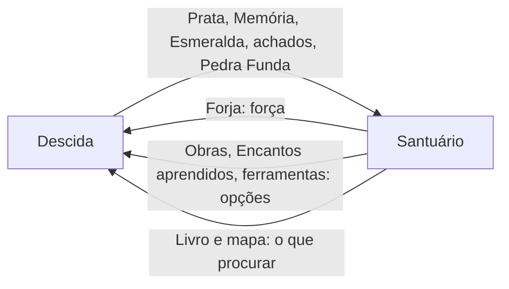
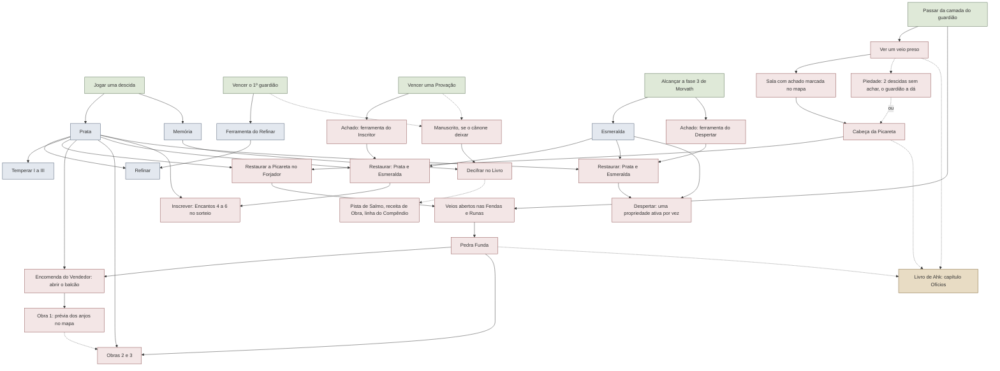

# Ofícios e Descobertas: visão do ecossistema e grafo de dependências

- 2026-11-20, `game-director`. Só planejamento. Legenda de estado no `README.md`.
- Base: `01_diagnostico.md`, `16_arquitetura.md`, `05_coleta_e_regioes.md`, `10_economia.md`, `10_ux.md`,
  `docs/design/rejogabilidade/sistemas.md`.

## 1. Visão em uma frase

[PROPOSTA NOVA] **A descida esconde coisas que o Santuário sabe usar, e o Santuário devolve à descida opções, não
força.** O jogador volta a uma região porque viu ali algo que ainda não podia abrir, e volta ao hub porque um NPC sabe o
que fazer com o que ele trouxe.

## 2. Os papéis (quem faz o quê)

| Papel | Quem | Estado |
|---|---|---|
| Fonte de tudo que se acha | a descida: salas, elites, guardião, Provação, Morvath, e o veio (novo) | [EXISTENTE] + veio [PROPOSTA NOVA] |
| Materiais de gasto amplo (moedas) | Prata, Memória, Esmeralda | [EXISTENTE] [APROVADO Q-RJ2 a] |
| Item de ofício contável (não moeda) | Pedra Funda, teto 10, só para Obras | [PROPOSTA NOVA] [PENDENTE Q-OF4] |
| Achados únicos | ferramentas partidas (Picareta; depois as das Fatias 3), manuscritos se o cânone deixar | `tool_refine` [EXISTENTE]; resto [PROPOSTA NOVA] |
| Oficina (restaurar ferramenta, Forja, Despertar, Inscrever) | o Forjador | Forja [EXISTENTE]; oficina [PROPOSTA NOVA] |
| Obras e encomendas | o Vendedor (o "Mercador" do pedido) | estação [EXISTENTE], função [PROPOSTA NOVA] |
| Consulta, pistas, decifrar | o Livro de Ahk (o "Guardião dos Manuscritos" do pedido, sem NPC) | Livro [EXISTENTE] [CÂNONE: Ahk]; capítulo Ofícios [PROPOSTA NOVA] |
| Registro do que se viu | o Compêndio | [EXISTENTE], contagem nova [PROPOSTA NOVA] |
| Força permanente | só a Forja (Temperar, Refinar) e os Dons | [EXISTENTE] [APROVADO 2026-11-19, decisão 3] |
| Opções permanentes | Obras, Inscrever, Despertar (troca), ferramentas que abrem fontes | [PROPOSTA NOVA] |

## 3. O laço de jogo (não é o grafo de dependência)

O laço gira: a descida dá, o hub gasta, a descida seguinte muda. Isso é desejado. O grafo da seção 4, que diz **o
que precisa existir para outra coisa existir**, não pode ter ciclo.

## 4. Grafo de dependências (Roteiro A e B)

Convenção: seta cheia = **obrigatório** (sem a origem, o destino não existe); seta tracejada = **opcional** (acelera ou
enriquece, nunca é preciso); nós com `ou` = **alternativas** (qualquer uma serve). Fontes de partida (verde claro) só
dependem de jogar.

### 4.1 Como ler o grafo

- **Obrigatório**: a Picareta pede a cabeça **e** Prata; os veios pedem a Picareta **e** passar da camada do guardião.
- **Alternativa**: a cabeça vem da sala marcada **ou** da piedade (o guardião a entrega depois de 2 descidas sem ela).
- **Opcional**: o Livro, as Obras 2 e 3, as pistas dos manuscritos: nada depende delas.
- **Nada da força depende dos Ofícios**: Temperar e Refinar continuam pagos só com Prata e a ferramenta do Refinar.
  Quem nunca toca num veio vence Morvath igual.

### 4.2 Garantias de que não há ciclo nem bloqueio

| Regra | Como se garante | Teste (de `16_arquitetura.md` 5) |
|---|---|---|
| Nenhuma ferramenta é pedida para andar, abrir porta, pegar recompensa ou vencer sala | o veio é peça sem colisão nova; o ponto preso só tranca a si mesmo | `test_boss_exits`-like no veio, 12 x 12 posições |
| Nenhuma receita pede o que só a própria receita abre | a Picareta não pede Pedra Funda; nenhum restauro pede o produto dele | `test_the_oficios_graph_has_no_cycle` |
| Todo item essencial tem fonte que vale na derrota | cabeça, Prata, Memória e achados de marco são guardados na morte; a Esmeralda pede a fase 3, então só o Roteiro B, opcional, depende dela | `test_every_essential_is_reachable_from_a_fresh_save`, `test_no_essential_needs_a_victory` |
| Sorte que nunca vem | piedade de 2 descidas para a cabeça e para os achados de marco | `test_pity_marks_within_n_runs` |
| O mapa da mesma semente não muda | marcas com sal próprio depois do grafo; nenhuma carta nova no baralho | `test_finds_leave_the_map_as_it_was` |

### 4.3 Roteiro C (fora do grafo de agora)

Alquimista, Cera, Fungo, Pó de Runa e decalques entram só se A e B provarem que o laço diverte (`18_roadmap.md`).
Cada um teria de entrar no grafo como **opcional** e sem ciclo, ou não entra.

## 5. Orçamento de complexidade do capítulo 1 (teto)

[PROPOSTA NOVA], do `10_economia.md` 5 e do `10_ux.md` 12, conferido com esta síntese:

| Item | Hoje | Teto no fim do Roteiro B |
|---|---|---|
| Contáveis persistentes | 3 | 4 (Pedra Funda) |
| Achados únicos | 1 | 5 (3 ferramentas novas, até 2 manuscritos se aprovados; mais o `tool_refine`) |
| Receitas e compras no hub | 9 | 17 (3 restauros, 3 Inscrever, Despertar 3, 3 Obras, Forja de hoje) |
| NPCs com função | 1 (Forjador) | 2 (Forjador e Vendedor) |
| Elos numa cadeia | | 3 no máximo (ver, achar, restaurar) |
| Coleta por descida | 0 | até 2 veios, menos de 10 s no total |
| Telas novas | | 1 (capítulo Ofícios do Livro); o resto reusa `HubPanel` e `ForgeScreen` |
| Elementos novos na HUD da luta | | 0 |
