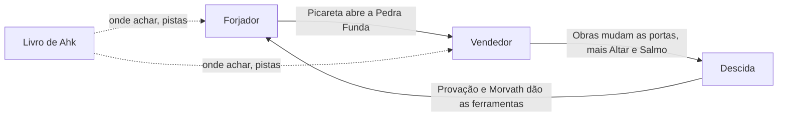

# Ofícios e Descobertas: NPCs e encomendas

- 2026-11-20, `game-director`. Só planejamento. Legenda no `README.md`. Interface das folhas em `10_ux.md` 10.4 a 10.6;
  dados e estados em `16_arquitetura.md` 1 e 4.

## 1. NPCs: só os que existem

O pedido lista Forjador, Artesão, Alquimista ou Ervanário, Guardião dos Manuscritos e Mercador. A recomendação é **não
criar nenhum NPC novo no capítulo 1**:

| Pedido | Fica com | Por quê | Estado |
|---|---|---|---|
| Forjador | o Forjador (boneco assado, forja, bigorna, Forja da Emeth) | já é o dono do metal e das ferramentas (`tool_refine`) | [EXISTENTE] |
| Artesão | **o Forjador**, aba "Oficina" na `ForgeScreen` | restaurar ferramenta é trabalho de metal; um Artesão separado dividiria a mesma Prata em duas estações | [PROPOSTA NOVA] |
| Mercador | **o Vendedor** (balcão com toldo, boneco assado, hoje "Balcão fechado") | D-H1 já reservou o Vendedor para a loja do hub; a Fatia 3 já previa as Obras nele | [EXISTENTE] estação; função [PROPOSTA NOVA] |
| Guardião dos Manuscritos | **o Livro de Ahk** (estação do atril), sem pessoa | Ahk é [CÂNONE] (o escriba de Elun); pôr um NPC "guardião" ao lado do Livro é lore nova e duplicaria a estação | [PENDENTE Q-OF8] |
| Alquimista ou Ervanário | **descartado no capítulo 1** | pede estação nova (planta do hub, teste de 4 s entre estações, peça, boneco: custo G de várias frentes, `16_arquitetura.md` 6), dois a três recursos novos (Cera, Fungo) e o "consumível" de combate vira Bênção fabricada, que o próprio pedido proíbe | [PROPOSTA NOVA: descartar] |

Justificativa forte que faria um NPC novo valer (critério para o Roteiro C): ele precisa de **uma função que nenhuma
estação faz**, **um material que já sobra** para gastar e **uma relação** com outro NPC que o jogador sinta. Nenhum dos
propostos passa nos três hoje.

Nomes: Forjador e Vendedor seguem nome de função (Q-RJ11, Q-H3). [CÂNONE] O Prólogo do RPG tem moradores de Valmor (o
mascate Otávio, Zélia, Bento), mas vivem séculos depois do prelúdio (a selagem é antiga); usar um deles mudaria a
cronologia. Pergunta em `22_decisoes_pendentes.md` (Q-OF10).

## 2. Estados de uma encomenda

[PROPOSTA NOVA] Um estado por encomenda no save (`oficios.orders`), uma entrega só, nunca repetível:

| Estado | Significa | O que o jogador vê |
|---|---|---|
| oculta | o que a revela ainda não aconteceu | nada |
| aberta | revelada; falta algo | placa da estação: "Tem um pedido"; folha com PEDE, ONDE ACHAR, DÁ |
| pronta | tudo na Bolsa | placa em ouro: "Pronto para entregar"; Entregar com foco |
| entregue | paga e recompensada na mesma mutação | entrada no Livro em tinta apagada; a recompensa no lugar dela |

Sem prazo, sem espera por relógio nem por descidas (`10_economia.md` 3, `10_ux.md` 10.6).

## 3. As cinco cadeias

Cada cadeia: origem, objetivo, pré-requisitos, recursos, local, recompensa, persistência, estado, relações, impacto.

### C1. A Primeira Picareta (Forjador) [PROPOSTA NOVA, Roteiro A]

- **Origem**: o herói passa da camada do guardião, entra nas Fendas ou nas Runas, vence a sala e vê um veio escuro que
  não abre: a placa diz "Pede: Picareta". O Livro anota "Veio preso" com a região.
- **Objetivo**: trazer a cabeça partida de uma picareta ao Forjador.
- **Pré-requisitos**: ter visto um veio preso (revela a encomenda). Nada mais.
- **Recursos**: o achado "Cabeça da Picareta" (único) e 20 de Prata.
- **Local**: a cabeça cai numa sala de luta marcada no mapa (profundidade 4 a 8, sal próprio `FIND_SALT`), nas
  descidas depois do veio preso; com 2 descidas passando do guardião sem achá-la, o próprio guardião a entrega
  (piedade). Restaura-se no Forjador, aba Oficina.
- **Recompensa**: a Picareta (ferramenta em `heroes.warrior.tools`): os veios das Fendas e das Runas passam a abrir e
  dar Pedra Funda.
- **Persistência**: o achado é guardado na morte (como os materiais, `Game.log_run`); a encomenda e a ferramenta no
  save do espaço; robô e `--nosave` nunca guardam.
- **Estado**: oculta até o veio preso; aberta; pronta quando a cabeça e os 20 de Prata estão na Bolsa; entregue.
- **Relações**: a Pedra Funda que a Picareta abre é o pedido do Vendedor (C2). Forjador e Vendedor se ligam pelo
  produto, sem sistema de afinidade.
- **Impacto**: horizontal (uma fonte nova). Disputa a Prata com o Temperar II (35) entre a 2ª e a 5ª descida: a
  primeira escolha de verdade no hub.

### C2. O balcão do Vendedor (Vendedor) [PROPOSTA NOVA, Roteiro A]

- **Origem**: a primeira Pedra Funda colhida. A placa do Vendedor troca "Balcão fechado" por "Tem um pedido".
- **Objetivo**: 2 de Pedra Funda e 30 de Prata para assentar o balcão.
- **Pré-requisitos**: C1 entregue (a Pedra Funda só existe com a Picareta).
- **Recursos**: 2 Pedra Funda, 30 Prata.
- **Local**: veios (Fendas e Runas depois do guardião); a Prata de qualquer fonte. Entrega no Vendedor.
- **Recompensa**: o Vendedor abre as **Obras** e faz a primeira, a "Prévia dos anjos" (o mapa mostra o anjo das salas de
  Bênção da camada seguinte, não só das portas abertas). Horizontal: informação.
- **Persistência**: save do espaço; a Obra vale em toda descida seguinte, lida no começo (cópia, como `_equip_forge`).
- **Estado**: oculta, aberta, pronta, entregue.
- **Relações**: só existe por causa do Forjador (C1). Abre C3 (Obras 2 e 3).
- **Impacto**: o Vendedor deixa de ser um placeholder; a decisão "que porta pego" ganha uma camada de leitura sem
  somar força.

### C3. As Obras do Santuário (Vendedor) [APROVADO como ideia na Fatia 3 do `sistemas.md` 1.7; números PROPOSTA NOVA, Roteiro B]

- **Origem**: C2 entregue. A folha do Vendedor vira dupla (índice das Obras, Obra em foco).
- **Objetivo**: comprar as Obras 2 e 3, uma por vez, na ordem que quiser.
- **Pré-requisitos**: C2.
- **Recursos**: Obra 2 "Altar mais frequente" 40 Prata e 3 Pedra Funda; Obra 3 "Salmo mais cedo" (porta de Salmo desde
  a sala 3) 50 Prata e 3 Pedra Funda (`09_receitas_e_ferramentas.md`).
- **Local**: Vendedor.
- **Recompensa**: regras de porta (mais Altar, Salmo mais cedo). Mexem em Elo e Salmo, que hoje não pesam na vitória
  (`balance.md` 3.6), então seguras para a curva.
- **Persistência**: save; liga e desliga na folha (uma Obra comprada pode ser desligada, para quem quer a descida
  antiga) [HIPÓTESE: útil para Juramentos].
- **Estado**: cada Obra com oculta, aberta, comprada.
- **Relações**: consome a Pedra Funda que o Forjador abriu; o Altar mais frequente puxa Prata para o Altar
  (troca de ouro por Magia), que é da descida.
- **Impacto**: estende a Prata e a Pedra Funda até a 18ª a 22ª descida (meta E4).

### C4. A ferramenta do Inscritor (Forjador e Encantos) [APROVADO como ideia na Fatia 3; detalhe PROPOSTA NOVA, Roteiro B]

- **Origem**: a primeira Provação vencida (marco, Q-RJ9 a). O achado "ferramenta do Inscritor, partida" (nome de
  trabalho) cai na virada da maldição.
- **Objetivo**: restaurá-la no Forjador.
- **Pré-requisitos**: uma Provação vencida (piedade não precisa: a laje aparece em boa parte das descidas e pagar é
  escolha do jogador; se o Daniel quiser, a 1ª vitória sobre Morvath também a dá).
- **Recursos**: 40 Prata e 2 Esmeralda para restaurar; depois 20 Prata por Encanto inscrito (como o `sistemas.md` 1.5).
- **Local**: Forjador, aba Oficina e depois a trilha Inscrever.
- **Recompensa**: Encantos 4 a 6 passam a poder sair na descida (`forge.inscribed`, que o `Enchants.learned` já lê).
  Horizontal: mais variedade no sorteio, não mais força.
- **Persistência**: ferramenta e Encantos inscritos no save.
- **Estado**: oculta até a Provação vencida; aberta; pronta; entregue; depois três Inscrições.
- **Relações**: **primeiro destino da Esmeralda** (hoje sem gasto); a Provação ganha um motivo além da Bênção.
- **Impacto**: rejogabilidade (Encantos novos), sem força nova. Pede o combat-feel-director nos três Encantos.

### C5. A ferramenta do Despertar (Forjador) [APROVADO como ideia na Fatia 3; detalhe PROPOSTA NOVA, Roteiro B]

- **Origem**: alcançar a fase 3 de Morvath pela primeira vez (marco). O achado cai na mudança de fase.
- **Objetivo**: restaurar a ferramenta e despertar a lâmina.
- **Pré-requisitos**: fase 3 alcançada.
- **Recursos**: restaurar 30 Prata e 1 Esmeralda; cada Despertar 3 Esmeralda (três propriedades, uma ativa por vez,
  troca grátis).
- **Local**: Forjador, trilha Despertar.
- **Recompensa**: uma propriedade da lâmina por vez (molde do aspecto do Hades II). Lateral: troca, não soma.
- **Persistência**: save (`forge.awaken`, já no `SaveData.forge_defaults`).
- **Estado**: oculta, aberta, pronta, entregue; depois cada Despertar comprado.
- **Relações**: segundo destino da Esmeralda; a Esmeralda por recorde de Peso nos Juramentos (Fatia 3) alimenta aqui.
- **Impacto**: o único ofício que mexe na sensação do golpe; só entra depois do C1 a C4 provarem o laço, com o
  combat-feel-director e o balance-designer (teto: dentro do ruído de vitória, `20_metricas.md`).

### (Reserva) C6. Os registros do presbitério (Livro) [PENDENTE Q-OF8, Roteiro B só se aprovado]

- Vencer o guardião no Santuário Desmoronado (a casa dele) dá, uma vez por descida e até 3 no capítulo, um manuscrito;
  decifrar no Livro custa 4 a 8 de Memória (desde a 8ª descida, para não competir com os primeiros Dons) e dá uma pista
  de Salmo, a receita de uma Obra ou uma linha do Compêndio. Nunca abre Dom (D-57).
- O que é o manuscrito é lore: [CÂNONE] o Livro Sagrado de Yah é a compilação dos papiros de Ahk; a Ordem de Erukh guarda
  os registros dos selos desde Hanokh. Um "registro da Ordem" ou "cópia de um papiro" numa igreja sobre um selo é
  plausível, mas é invenção: só com o Daniel.

## 4. Relações entre os NPCs (sem sistema de afinidade)

A relação é **o produto de um NPC ser o pedido do outro**, legível no Livro ("Usado em: Obra 1"). Sem barra de
amizade, presente ou diálogo ramificado (custo de texto e de lore alto; nada pedido pelo combate).

## 5. O que muda no hub

- Nenhuma estação nova, nenhuma planta nova (o teste de 4 s entre estações continua).
- A `StationSign` diz "Tem um pedido" ou "Pronto para entregar" (`10_ux.md` 10.4); nada de ponto de exclamação.
- Os bonecos podem ganhar um gesto ao entregar (o Forjador já tem séries de golpes; o Vendedor o `Interact`), sem
  boneco novo.
